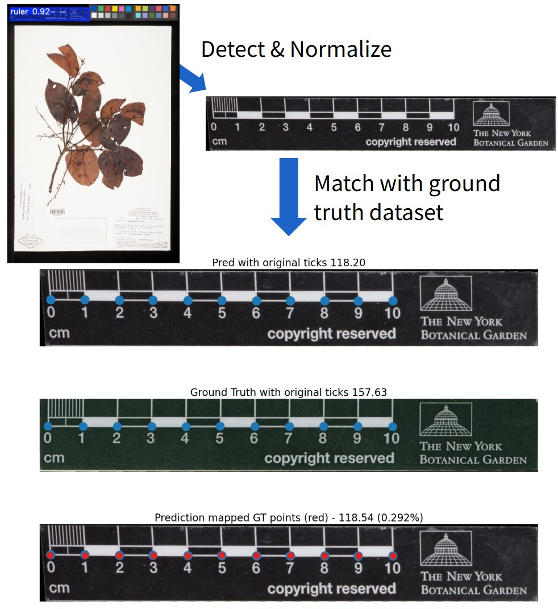

## Ruler Detection & Scale Estimation

This repository contains the updated code for estimating a scale factor (conversion from pixels to metric) by detecting the rulers on a given image.

It uses below tools:

- [RF-DETR](https://github.com/roboflow/rf-detr) for ruler detection
- [DINOv3](https://ai.meta.com/research/dinov3/) to match with the ground truth dataset
- [LoMa](https://github.com/davnords/LoMa) for keypoint matching and homography estimation

Install the environment with [install.md](install.md). 

Run on the sample images from [notebooks/scale_estimation.ipynb](notebooks/scale_estimation.ipynb), or from `ruler_inference.py`.

### Web demo & API coming soon

Will be published at: [herbaria.idlab.ugent.be](https://herbaria.idlab.ugent.be/)

### Dataset and evaluation

The ruler dataset and the evaluation code will be released soon.

### Contact & Collaboration

We actively encourage collaboration with researchers and developers interested in:

- Extending the dataset (new ruler types or annotations)
- Benchmarking new models or algorithms
- Integrating the methods or dataset into larger-scale projects

Feel free to reach out to: kenzo.milleville@ugent.be

### Citing this work

An updated publication is in the works.

Previous article: [Determining the Scale of Herbarium Sheet Images via Ruler Detection](https://doi.org/10.3897/biss.10.183602)

### License

The original code in this repository is licensed under the MIT License. See [LICENSE](LICENSE) for details.

This license does **not** extend to third-party software, libraries, model weights, or other assets used by this project. These components remain subject to their respective licenses and terms of use.

In particular:

- **RF-DETR:** Apache License 2.0 for the open-source package and applicable model weights. Some model variants are subject to different licensing terms.
- **LoMa:** MIT License for most of its code, with the matcher inheriting the Apache License 2.0 from LightGlue.

Users are responsible for complying with the applicable licenses and terms for third-party components they use or redistribute.

#### Previous release

The previous (outdated) code and dataset are available at [herbarium-rulers](https://github.com/kymillev/herbarium-rulers).
